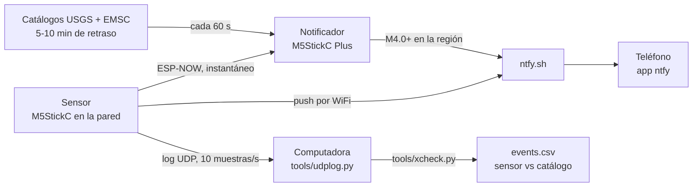

# seismoM5: fork para monitorear réplicas

*[Read in English](README.md)*

Este es un fork de [febalci/seismoM5](https://github.com/febalci/seismoM5), el sensor sísmico para M5StickC creado por **febalci**. El repositorio original está archivado, así que los cambios viven aquí. Todo el crédito del sensor es del proyecto original: la calibración del MPU6886, los disparadores por PGA y STA/LTA, la página web de ajustes y la integración con MQTT. Gracias a ese trabajo pudimos armar un sistema funcional en una sola noche.

## Por qué existe este fork

Este fork se armó durante la secuencia de réplicas del sismo M7.7 frente a Panamá del 9 de octubre de 2026. Partir de un sensor que ya calibraba y medía permitió tener algo funcionando esa misma noche, y casi todo lo que se agregó salió de prueba y error con réplicas reales:

- **Dos sticks, dos trabajos.** El sensor queda fijo y solo mide; un segundo stick (un M5StickC Plus) es el notificador y puede ponerse donde la gente lo vea.
- **Los niveles de alarma salieron de los datos.** A 150-200 km, una réplica es más débil que un golpe en el escritorio pero sigue varios segundos; por eso los dos niveles se basan en la duración y no solo en el pico.
- **Primer resultado:** detectó una réplica M5.1 a 155 km (confirmada por EMSC); a esa distancia se ve poco por debajo de M4.5.

## Cómo funciona

El sensor le avisa al notificador por ESP-NOW, una radio directa entre ESP32 que no pasa por internet, y al mismo tiempo manda un push al teléfono. El notificador además consulta los catálogos USGS y EMSC cada minuto. Como los catálogos publican de 5 a 10 minutos después del sismo, sus eventos se muestran en pantalla y llegan al teléfono sin sonido.

## Qué agrega este fork

### Sensor (`src/`)

- **Vuelve a compilar.** Versiones fijadas: `espressif32@6.10.0`, ESPAsyncWebServer en el commit `f71e3d4` y WebSerial `~1.4.0`; las versiones nuevas ya no compilan este código.
- **PGA sin deriva.** El PGA se mide contra un promedio móvil de 30 s de la aceleración, no contra la calibración del arranque. Con el código original el ruido de fondo se triplicó durante la noche (de 0.0008 g a 0.0024 g), probablemente por temperatura; ahora queda en unos 0.0006 g.
- **Dos niveles de alarma, los dos basados en duración.** Un golpe es un pico corto; un sismo sigue varios segundos.

  | Nivel | Regla (10 muestras/s, ventana de 5 s) | Notificador | Teléfono |
  | --- | --- | --- | --- |
  | Azul: posible réplica | 12 de 50 muestras sobre 0.006 g | Pantalla azul, LED lento, un "tu tu tu tu" | Push normal |
  | Rojo: vibración fuerte | 10 de 50 muestras sobre `pga_trigger` (0.015 g) | Pantalla roja, alarma completa | Push urgente |

  Un evento azul que crece pasa a rojo en el momento. Probada sobre un día completo de datos, la regla roja no se disparó ni una vez con golpes al escritorio de hasta 0.05 g. El azul sí se dispara cuando hay gente moviéndose cerca; es el precio de detectar réplicas lejanas.
- **Recalibración automática por inclinación.** Una lectura fija sobre el umbral durante 60 s es un sensor movido, no un sismo: se recalibra solo y avisa al teléfono.
- **Avisos al teléfono con ntfy**, con prioridad según el nivel, enviados uno por uno desde una cola (dos conexiones TLS a la vez dejan al ESP32 sin memoria).
- **ESP-NOW al notificador:** inicio del evento, cambio de nivel, fin, y una señal de vida cada 10 s.
- **Página de detecciones** en `http://seismom5.local/events`: los últimos 20 eventos con hora, nivel, pico y duración, guardados aunque se reinicie.
- **Registro por UDP:** cada muestra y cada línea de log van a una computadora por WiFi, así el sensor no necesita un cable a la computadora.

### Notificador (`notifier/`)

Un proyecto PlatformIO aparte para un segundo stick (aquí un M5StickC Plus):

- Recibe al sensor por ESP-NOW y muestra la alarma azul o roja, con el estado del sensor y el último pico local.
- Consulta USGS y EMSC cada 60 s para la región, junta el mismo sismo reportado por los dos (±60 s, 100 km) y manda al teléfono los M4.0+ sin sonido.
- Porcentaje de batería, indicador de carga, y un push cuando se pierde o vuelve la corriente USB.
- **Modo silencio** con una pulsación larga del botón A, guardado aunque se reinicie: las alarmas siguen en pantalla y en el LED.
- Se actualiza por WiFi (ArduinoOTA).

### Herramientas (`tools/`)

- `udplog.py` recibe el log por UDP y escribe `logs/pga_<fecha>.csv`.
- `xcheck.py` compara un día de datos del sensor con el catálogo EMSC. Para cada sismo calcula cuándo debía llegar la onda S y qué midió el sensor en ese momento. Escribe `logs/events.csv` y las muestras crudas de cada evento, y junta tus propias notas de `logs/labels.csv` ("alguien se sentó", "se cerró una puerta"), para que las falsas alarmas se vuelvan datos etiquetados.

## Instalación

1. Copia `src/secrets.example.h` a `src/secrets.h` y llena el WiFi, el tema de ntfy (difícil de adivinar: quien lo sepa puede leer tus avisos y mandarte falsos) y el nombre de la computadora que guarda el log. Git ignora `secrets.h`.
2. Flashea el sensor: `pio run -e m5stick-c -t upload` (o `m5stick-c-plus`). Agrega `PLATFORMIO_BUILD_FLAGS="-DPGA_STREAM"` para mandar también cada muestra por el puerto serie.
3. Fíjalo bien y déjalo quieto unos 30 s mientras se calibra; sirve cualquier orientación. Después pon el umbral de PGA en 0.015 g en `http://seismom5.local`. Para recalibrar después sin tocarlo, abre `http://seismom5.local/recal`.
4. Flashea el notificador: `cd notifier && pio run -e m5stick-c-plus -t upload`; las siguientes actualizaciones van por WiFi con `pio run -e ota -t upload`. Ajusta tu región en `notifier/src/notifier_config.h`.
5. En el teléfono, instala [ntfy](https://ntfy.sh) y suscríbete a tu tema.
6. Registro opcional: `python3 tools/udplog.py logs` y luego `python3 tools/xcheck.py logs/pga_<fecha>.csv`. Pon tu ubicación con `SEISMO_HOME=lat,lon`.

**Botones del notificador:** A cierra una alarma, una pulsación larga de A activa o quita el silencio, B hace una prueba de 3 s de la alarma roja.

## Lo que aprendimos

- **El lugar importa más que el algoritmo.** En un escritorio, la gente genera más vibración que una réplica M5. En la pared, el primer intento falló porque la cinta fue cediendo con el peso del cable hasta que el stick se cayó; pega también el cable a la pared, no solo el stick. Un cable USB a la computadora también le pasa al sensor la vibración del escritorio; por eso el registro pasó a WiFi.
- **Calibra donde se va a quedar.** Medio grado de inclinación ya se lee como 0.008 g.
- **Abrir el puerto serie reinicia estos sticks**, y el sensor se recalibra. Mejor usar OTA y el registro por UDP.
- **Prueba las reglas con datos grabados antes de flashear.** Cada regla de este fork se probó primero sobre el log del día completo.
- **Es un aparato amateur.** A 150-200 km ve aproximadamente M5 o más. No reemplaza una red sísmica, pero avisa minutos antes de que publiquen los catálogos.

El README original de febalci, en inglés, sigue completo en [README.md](README.md#original-readme-by-febalci).
